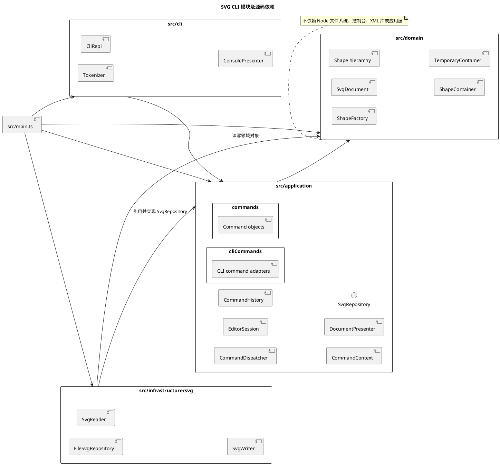
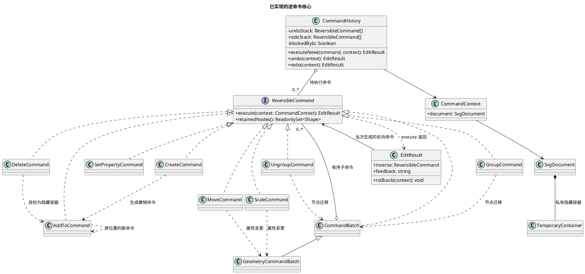
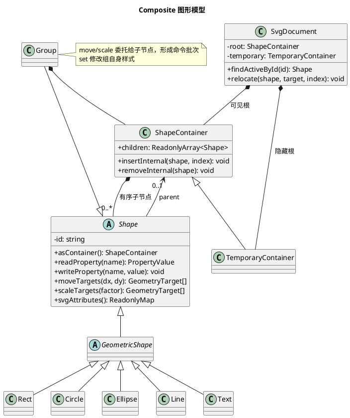
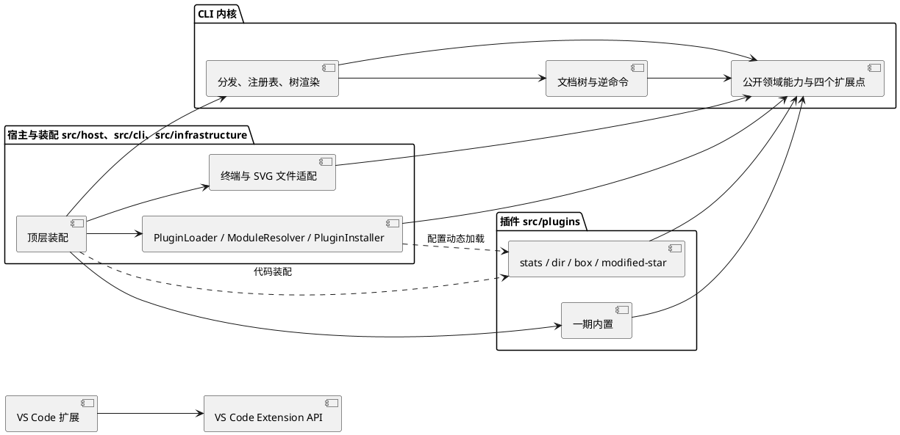

# SVG 编辑器（CLI）设计文档

依据：[phase_cli_1.md](../phase_cli_1.md)与 [phase_cli_2.md](../phase_cli_2.md)。一期基础编辑器已实现，二期见[设计方案](#二期设计方案)。开发环境、协作约定及运行方式见[根 README](../README.md)。

约束：TypeScript、面向对象、字段封装、一类一文件且文件名与类名一致；使用 Command 和 Composite；禁止文档快照；按名字分派仅允许出现在命令分发和图形工厂两处。

## 1. 一期架构方案（重构前）

### 1.1 模块划分

| 模块（目录） | 职责 | 主要对象 |
|---|---|---|
| `src/domain/` | 图形几何和属性规则、唯一 id、文档树、父子关系及顺序；原子迁移节点；保管已删除对象 | `SvgDocument`、`Shape`、`GeometricShape`、`Rect/Circle/Ellipse/Line/Text/Group`、`ShapeFactory`、`ShapeContainer`、`TemporaryContainer` |
| `src/application/` | 编辑会话、命令分发、上下文、撤销重做、显示内容；声明存储接口 | `EditorSession`、`CommandDispatcher`、`CommandContext`、`EditResult`、`CommandHistory`、`DocumentPresenter`、`SvgRepository` |
| `src/application/commands/` | 可逆编辑命令与批次；属于 application 模块 | `ReversibleCommand`、`AddToCommand`、`CreateCommand`、`DeleteCommand`、`SetPropertyCommand`、`MoveCommand`、`ScaleCommand`、`GroupCommand`、`UngroupCommand`、`CommandBatch` |
| `src/application/cliCommands/` | 命令语法、参数检查及用例适配；属于 application 模块 | `CliCommand`、`CommandArguments`、各 `*CliCommand`；命令名只在分发器中映射 |
| `src/infrastructure/svg/` | 文件与 XML 读写；保留子节点顺序，导入时补缺失 id，生成警告 | `FileSvgRepository`、`SvgReader`、`SvgWriter`、`SvgElement` |
| `src/cli/` | REPL、`svg>` 提示符、逐行输入、引号切分、整行注释识别及反馈输出 | `CliRepl`、`Tokenizer`、`ConsolePresenter` |
| `src/main.ts` | 创建具体对象、注入依赖并启动程序 | 组装入口 |

`application/commands/` 是应用层内部目录，不是独立架构层。接口、枚举和只读传输类型可以单独成文件；图形业务状态由类封装，不能通过公开可写字段绕过校验。

#### PlantUML 包图

箭头表示源码依赖。接口实现也需要引用接口，因此 infrastructure 指向 application；运行时 application 通过接口调用读写实现。



### 1.2 设计模式的选择与落地

#### Command：命令对象与撤销重做

`ReversibleCommand` 声明 `execute(context)` 和 `retainedNodes()`；执行结果 `EditResult` 包含本次即时生成的反向命令。编辑、撤销和重做都通过命令的 execute 完成。CLI 适配层实现 `CliCommand`，负责检查参数并调用会话用例，避免把输入文本传进图形模型。

各具体命令直接实现该接口，尚不引入没有实际用途的编辑基类。`CommandHistory` 的两个栈均保存“下一次需要执行的命令”：新编辑成功后将其反向命令压入 undo；undo 执行栈顶命令，将当场生成的反向命令压入 redo；redo 对称处理。每次生成一个新命令对象，不把刚执行的旧对象直接搬到另一栈。

例如 delete 将对象移入临时容器，undo 栈保存指向原父容器和原位置的 AddToCommand；撤销时执行该迁移，并即时生成指向临时容器的新 AddToCommand 放入 redo 栈。不再设置独立的 MoveToTemporaryCommand、RestoreCommand。[完整伪代码](undo_redo_pseudocode.md)描述统一迁移、栈操作和回收。

| 命令类别 | 实现 | 历史策略 |
|---|---|---|
| 当前编辑核心 | `CreateCommand`、`DeleteCommand`、`SetPropertyCommand`、`AddToCommand`、`CommandBatch` | 成功后生成反向命令，作为一个撤销单元入 undo 栈，同时清空 redo 栈 |
| 分组、排列、几何 | `GroupCommand/UngroupCommand` 使用批次；`front/back` 直接适配 AddTo；`MoveCommand/ScaleCommand` 使用属性命令批次 | 每条用户命令一个撤销单元 |
| 文档操作 | `InitCliCommand`、`ReadCliCommand`、`SaveCliCommand`、带尺寸的 `CanvasCliCommand` | 对应会话方法成功后建立历史屏障 |
| 查询 | `TreeCliCommand`、`ShowCliCommand`、`HelpCliCommand`、无尺寸的 `CanvasCliCommand` | 不入栈，不改变已有历史 |
| 历史控制 | `HistoryCliCommand` | 调用 CommandHistory，自身不入栈 |

原方案的独立 CommandRunner 没有创建：EditorSession 负责会话和用例，CommandHistory 负责可逆命令调用，职责已经覆盖。历史策略由具体会话方法落实，不再引入报告策略的枚举；分发器仅查表调用，不按命令名重复分支。

#### PlantUML 命令类图



#### 撤销记录：保存操作变化，禁止文档快照

不复制、克隆或序列化整个当前文档来实现撤销、重做或编辑事务。每个编辑命令只保存本次操作实际需要的记录。几何操作即使涉及整棵子树，也只记录受影响的数值属性，不记录完整图形或完整文档。

| 编辑命令 | 需要保留的记录 | 撤销与重做 |
|---|---|---|
| `create` | 创建出的原图形对象、父容器、插入位置 | 返回目标为临时容器的 AddToCommand；执行后再生成回原位置的 AddToCommand |
| `delete` | 移入临时容器的原子树对象、原父容器和位置 | 返回指向原位置的 AddToCommand；恢复时返回指向临时容器的新 AddToCommand |
| `move` | 增量参数及本次改变的坐标属性旧值、新值 | 写回旧值或新值 |
| `scale` | 缩放参数及本次改变的几何属性旧值、新值 | 写回旧值或新值，避免乘倒数带来的浮点误差 |
| `set` | 属性名、原来是否存在、旧值、新值 | 恢复原值或原本的缺省状态；重做设置新值 |
| `group` | 新组对象及其位置、每个成员的原父容器和原位置、组内顺序 | 撤销移回成员并将新组移入临时容器；执行时生成重做分组命令 |
| `ungroup` | 移入临时容器的原组对象及其位置、被提升的子节点顺序 | 撤销恢复原组并收回子节点；执行时生成再次解散命令 |
| `addto` | 节点的原父容器和位置、目标容器和目标位置 | 撤销迁回；重做迁入 |
| `front/back` | 节点及原位置、目标位置 | 在同一父容器内恢复或调整位置 |

`SetPropertyCommand` 记录目标属性值，包含“属性不存在”的状态；执行时捕获原值生成逆命令。`AddToCommand` 记录节点、目标父容器及可选位置，执行时捕获原父容器与位置生成逆命令。这些命令通过领域方法修改对象，不能直接修改内部数组或字段。

`CommandBatch` 顺序执行子命令，逆命令按相反顺序组成新批次。group 即使包含多次节点迁移，仍只占一个历史单元。move/scale 由图形多态计算几何目标值，组合为属性修改批次；撤销写回原数值，避免通过乘倒数恢复浮点数。

GeometryCommandBatch 在首次写入前校验全部计算结果为有限数，然后复用 CommandBatch 执行和回退；空容器、零位移和倍率 1 仍是合法的一个撤销单元。

addto 的可选 index 从 0 开始，省略时追加；同父容器迁移按移除节点后的列表解释。内部传递容器引用，CLI 只允许解析可见 g 的 id。根和隐藏临时容器不是用户可寻址的 g。

#### 隐藏临时容器

`TemporaryContainer` 由当前文档私有持有，独立于可见 SVG 根；不是普通 `g`，没有可供用户寻址的 id。删除容器时把整棵原子树移入临时容器，保留内部父子关系及对象身份，不逐个复制其子节点。

公共 id 查找仅遍历可见树；tree/show/save 仅遍历可见根。隐藏对象及其子孙不会出现在公开查询和序列化结果中。内部逆命令持有对象引用和原位置，不能通过普通用户命令访问临时容器。

临时容器按对象身份管理，允许保管不同历史中具有相同 SVG id 的对象；可见树仍要求 id 唯一。恢复前检查整个子树的 id 冲突。新编辑清空 redo 或 I/O 屏障清空历史后，仅释放两栈不再引用的隐藏子树；仍可能恢复的隐藏父容器也必须保留。

#### 失败不改变状态

执行前的准备阶段校验所有参数、目标存在性、id 冲突、属性白名单、数值范围、树循环和祖先子孙冲突，并构造局部修改记录。该阶段不改变文档。

应用修改时，如果中途出现异常，`CommandBatch` 倒序调用成功子步骤的 `EditResult.rollback`。默认回退执行逆命令；尚未提交的 CreateCommand 则恢复为原本未挂载的状态，避免把失败创建残留在临时容器中。嵌套批次保留这项回退语义。父指针和子节点顺序由领域对象统一维护。

失败的执行、撤销或重做不改变历史栈。历史管理器先查看栈顶命令并执行，成功后才弹出原命令、将新生成的反向命令压入另一栈；准备失败的编辑命令不清空 redo 栈。

`read` 先解析并验证一个新文档，全部成功后才替换当前文档；这是导入结果，不是撤销快照。`save` 先生成 XML，再通过同目录临时文件写入和替换目标文件，成功后才更新会话信息及历史屏障。

#### 历史屏障

成功的 `init/read/save/canvas w h` 清空两个历史栈，并设置 `blockedByIo`。此时 `undo/redo` 均输出 `error: undo not allowed after io command`。下一条成功的编辑命令清除屏障并建立新的撤销记录；查询和失败的命令不解禁。

清空屏障前历史是本方案的补充决策：需求规定禁止撤销直到下一次编辑，但没有明确旧记录是否保留。丢弃旧记录可以避免跨文档恢复以及恢复到屏障前的状态。下一次编辑解除屏障后，若栈为空，使用普通的无历史错误。

#### Composite：容器与叶子的统一操作

`Shape` 封装 id、样式和父容器，GeometricShape 复用几何属性规则；各具体叶子声明自己的几何参数、移动轴和创建参数。Group 组合 ShapeContainer，递归汇总子节点的 move/scale 目标。文档根和隐藏临时容器提供有序子节点能力，但不是可由 id 编辑的普通图形。

容器通过 `asContainer()` 暴露容器能力，叶子返回空；命令用统一接口处理对象，不按 `tag` 判断具体类。`set g fill/stroke/stroke-width` 修改组自身的 SVG 样式属性，由 SVG 继承规则决定后代外观；不会强制覆盖子图形已有的属性。



领域对象的 summary 和 svgAttributes 提供只读描述，DocumentPresenter 负责 tree/show 布局，SvgWriter 负责 XML 转义与生成；领域层不引用 XML 库。节点迁移保留自身属性，不保证父级变换或样式继承下的视觉效果不变。

#### 工厂：集中图形类型分派

`ShapeFactory` 是唯一的“类型名 → 图形类”解析位置，供 create 和 SvgReader 共同使用。六种类型各自提供创建参数和属性定义，工厂统一转换位置参数及 XML 属性；读写和显示均不另写 switch(tag)。

本阶段明确标为待重构的两处：

| 位置 | 当前职责 | 后续重构方向 |
|---|---|---|
| `CommandDispatcher` | 命令名到命令构造器的内置映射，同时提供 help 元数据 | 增加命令注册入口 |
| `ShapeFactory` | 类型名到内置图形构造方式及参数定义的映射 | 改为 ShapeProvider 注册机制，统一创建与导入 |

### 1.3 依赖方向规则

以下规则覆盖源码 import 和运行时直接调用。接口实现属于源码依赖，不因采用依赖注入而豁免。

| 模块 | 允许依赖 | 理由 |
|---|---|---|
| `domain` | 自身内部模块、TypeScript/JavaScript 基础能力 | 领域规则能够脱离终端、文件系统和 XML 库运行 |
| `application` | 自身内部模块、`domain` | 用例协调领域对象；存储操作只引用本层声明的接口 |
| `infrastructure/svg` | 自身内部模块、`application` 的存储接口及传输类型、`domain`、Node 文件系统和 XML 库 | 实现存储接口，读写领域对象；不能调用执行器或历史栈 |
| `cli` | 自身内部模块、`application` 对外入口及结果类型、Node 终端能力 | 输入输出通过应用层完成，不直接修改图形或读写 SVG |
| `main.ts` | 上述全部模块 | 组装具体实现并注入依赖 |

接口 `SvgRepository` 位于 application，签名使用领域文档类型；`FileSvgRepository` 位于 infrastructure，实现该接口。application 不得 import `FileSvgRepository`、`node:fs` 或 XML 解析库。

违规示例：domain 引用 CLI 输出、application 引用具体存储类、CLI 直接操作 `Shape`、SVG 读取器修改撤销栈。发现违规时必须记为待处理项，修正依赖或如实修订方案；不能仅通过换目录名隐藏依赖。

当前全部模块按上述方向实现。DocumentPresenter 放在 application，使 CLI 不直接依赖 domain；FileSvgRepository 只引用应用层的存储接口和读入结果类型。查找通过可见树遍历完成，尚未维护 id 索引；只有性能需要时再增加索引。

2026-10-18 的依赖检查扫描了 63 个 TypeScript 文件及 249 处导入/重导出，未发现层级违规或类名与文件名不一致；每个类独立成文件。2026-10-25 按用户要求，仅另行检查第 2.1 节实现范式，见 implementation-paradigm-check.md。

### 1.4 变化点假设

| 可能的变化 | 本阶段预留 | 当前取舍与理由 |
|---|---|---|
| 增加图形类型及复合图形 `box` | `Shape` 多态、容器能力、单一工厂入口；创建和读取共享类型定义 | 先实现六种内置类型，工厂映射列为待重构；不实现插件发现、加载和 box，以符合阶段边界 |
| 增加 agent 或鼠标输入渠道 | 命令对象与执行器独立于 REPL；命令接收已解析参数 | 新入口可以直接构造命令；CLI 语法不进入图形模型 |
| 命令参数和反馈格式变化 | 每条命令独立检查参数；Tokenizer 只处理词法；Presenter 负责排版 | 不引入通用语法引擎，当前命令规模可以由各命令类处理 |
| SVG 导入导出规则变化 | 存储接口、独立 Reader/Writer、共享图形工厂 | 支持六种类型；保留额外属性和 transform；几何命令修改局部属性，不对导入变换做屏幕坐标换算 |
| 撤销记录的内存或性能需求变化 | 即时生成逆命令、集中历史管理器、隐藏临时容器及按历史引用回收 | 禁止文档快照；暂不实现持久化历史和历史分支，后续可增加条数上限 |
| 层级与排列操作增多 | 统一父容器接口和节点位置修改；树不变量集中维护 | 新操作复用节点迁移，不允许直接写 children 数组 |
| 新存储目标或测试替身 | `SvgRepository` 接口 | 仅实现本地文件；暂不引入数据库、远程服务等额外设施 |

### 1.5 需求未明确处的设计决策

- `group` 来自不同父容器时，按执行前文档的深度优先顺序排列成员，新组插入第一个成员的原父容器和原位置；若同时选中祖先与子孙，预检查拒绝。顺序及位置记录用于精确撤销。
- `front` 表示视觉最前，移到同级子节点数组末尾；`back` 移到开头，符合 SVG 后绘制节点覆盖先绘制节点的顺序。
- 仅整行去除前导空白后以 `#` 开始时视为注释；参数中的 `#4a90d9` 是颜色值，不能截断。
- 缺 id 的导入分两步：先收集全部显式 id 并检查重复，再分配不冲突的 `标签名+序号`，防止自动生成的 id 抢占后面的显式 id。
- 按需求禁止解散 SVG 直接子节点上的根级 `g`；该限制由 `UngroupCommand` 的准备阶段检查。
- 无参数 save 使用最近成功 read/save 的路径；失败读写不改变路径或历史。help/exit 在未初始化时可使用。
- SVG 尺寸支持单位为 px 的画布，几何属性采用有限浮点数；百分比尺寸、CSS 布局、DTD 及未知图形类型报错或不作布局计算。额外属性原样保留。
- XML 使用 saxes 解析，读入先完成全部校验后才替换当前文档。TypeScript 源码严格检查；skipLibCheck 只跳过依赖声明自身兼容性错误。

## 2. 过程记录

| 日期 | 讨论与修订 | 结果 |
|---|---|---|
| 2026-10-13 | 阅读需求并提出初步分层方案；最初建议复制文档以支持事务和撤销 | 初稿存在文档快照方案 |
| 2026-10-13 | 用户明确“文档快照被禁止” | 删除文档复制方案，改为 Command 保存属性变化、节点原位置及被摘出的原对象，通过局部逆操作撤销 |
| 2026-10-13 | 用户要求初始化 Git 并创建含 UML 的 README | 建立 Git 仓库；编写包图、Command 类图、Composite 类图及依赖和变化点规则 |
| 2026-10-13 | 用户要求在撤销时生成反向命令进入 redo，删除改为移动到不可访问的临时容器，并要求伪代码 | 两栈保存待执行命令，每次成功执行即时生成新的反向命令；补充隐藏对象的查询隔离、序列化隔离和回收规则；“不被 sl”暂按不被序列化解释 |
| 2026-10-13 | 用户提出统一图形和容器抽象、addto 增加 index、去掉专门的隐藏和恢复命令、暂缓 move/scale | 当前采用 AddToCommand 统一迁移及逆命令，保留容器能力边界；move/scale 后续用批次实现 |
| 2026-10-13 | 用户要求设计重点持续写入 README，Git 仅在其明确要求时操作，并要求可测试模块 | 记录协作约定，建立 TypeScript 逆命令模块；遵守 Git 操作限制 |
| 2026-10-18 | 用户要求 TypeScript 安装到 D 盘、Node.js 加入 PATH，并在具体路径说明后明确批准 | TypeScript 7.0.2 安装到 D:\dev-tools\typescript 并加入用户 PATH；既有 Node.js 已在系统 PATH；未安装项目依赖 |
| 2026-10-18 | 使用已安装编译器验证逆命令模块，发现批次中的失败创建不能仅作为用户撤销处理 | EditResult 增加事务回退操作；失败创建恢复未挂载状态；编译和 23 项测试通过 |
| 2026-10-18 | 用户要求完成基础功能，分别批准 saxes 和 @types/node@20 的工作区安装 | 完成六种图形、共享工厂、CLI、SVG 读写及全部基础命令；move/scale 按既定批次方案补齐 |
| 2026-10-18 | 独立执行器和策略枚举在实现中无额外职责 | 使用 EditorSession 协调用例，CommandHistory 执行编辑；新增 cliCommands 适配目录，保持依赖方向 |
| 2026-10-18 | 测试发现旧版 Node 在 Windows 不展开命令行通配符，沙箱临时目录限制文件替换 | 测试使用 node --test 自动发现；文件测试在已校验的工作区临时目录运行并清理；46 项测试通过 |
| 2026-10-18 | 用户替换安装规则 | 全部内容位于工作区且预计总安装大小小于 100 MB 时可直接安装；其他或不确定情况先逐项批准。Git 操作限制继续保留 |
| 2026-10-22 | 用户要求按已实现的功能分别提交 | 按构建配置、图形模型、逆命令与历史、移动缩放、分组解组、SVG 读写、CLI、文档示例组织八笔提交；不改变已有提交历史 |
| 2026-10-25 | 用户确认 move/scale 用属性命令批次完成，并要求先用固定用例、仅检查第 2.1 节，然后实现与测试分别提交 | 增加几何结果预检查；新增 72 项显式固定测试，完整 118 项回归通过；第 2.1 节未发现违规项 |

后续实现发现的设计调整应追加记录，不能把计划直接改写成已经验证的结论。

## 3. 一致性自查

当前已实现 Phase 1 基础功能；插件化 box 属于后续阶段。

| 检查项 | 当前状态 | 实现后检查方式 |
|---|---|---|
| 实际目录与模块方案一致 | domain/application/infrastructure/cli/main 均已实现；新增 cliCommands 子目录，未创建 CommandRunner | 差异已写入过程记录 |
| 实际依赖遵守规则 | 按层检查源码导入；存储依赖倒置通过 SvgRepository 实现 | 后续新增代码沿用检查 |
| 一类一文件、字段封装及多态 | 当前类独立成文件，业务状态使用私有字段 | 继续检查后续图形和工厂实现 |
| 仅两处名字分派 | CommandDispatcher 与 ShapeFactory；XML 读写和显示使用图形多态 | 两处都已标记为后续注册机制的重构点 |
| 撤销不使用文档快照 | 当前使用原对象引用、属性值、父容器和位置；无文档复制恢复 | 后续命令沿用该约束 |

## 4. 质量保证手段

2026-10-18：TypeScript 7.0.2 编译通过，npm test 的 **46 项测试全部通过**：23 项逆命令核心测试、13 项编辑器集成测试、8 项 SVG 测试、2 项词法及真实 CLI 测试。流程图脚本已通过真实 CLI 回放，产物为 examples/flowchart.svg。

2026-10-25：move/scale 预检查完成，新增 72 项固定测试，完整编译及 **118 项测试全部通过**；新增测试不使用随机种子或参数矩阵。测试编号和目标功能覆盖见 [fixed-test-cases.md](fixed-test-cases.md)。本次规范检查范围仅为“2.1 实现范式”，见 [implementation-paradigm-check.md](implementation-paradigm-check.md)。

已执行的验证：

- 回放两节点流程图，检查输出、嵌套操作和保存结果；真实 CLI 的失败命令逐行输出且后续命令继续执行。
- 验证编辑命令 execute → undo → redo，核对属性存在性、数值、父级及同级顺序；覆盖容器删除、跨父级 group、嵌套 ungroup、排序及 index。
- 针对错误命令验证文档及两栈不变，包括重复 id、无目标、非法属性、非正 scale、循环迁移和祖先子孙分组冲突。
- 用多步骤修改的中途失败场景验证批次回退，检查无节点丢失、无重复归属；将来若引入索引，同时检查索引一致。
- 验证 undo 后的新编辑清空 redo，失败编辑保留 redo；验证成功 I/O 屏障、失败 I/O 和 canvas 查询的区别。
- 验证 SVG 保存后读回的几何、样式、文本和顺序一致；覆盖 XML 转义、缺 id 自动命名及显式 id 冲突。
- 验证 undo/redo 每次执行生成新的反向命令；隐藏对象不可查询且不被序列化；按两栈引用回收时保留仍需恢复的节点与父容器。
- SVG 保存后读回验证几何、样式、Unicode 文本、XML 实体、CDATA、额外属性、transform、缺 id、命名冲突及隐藏节点隔离。
- 尚未进行浏览器截图比对；可手动在浏览器打开示例 SVG。当前验证不涵盖插件、CSS 计算或全 SVG 标准。

## 二期设计方案

按用户最新顺序，先完成 CLI 四个扩展点。默认仅装配一期能力，保留命令语义及输出、撤销和重做时即时产生逆命令、隐藏临时容器，以及禁止文档快照的约束。VS Code 实践及其余验收项见[二期任务书](../phase_cli_2.md)。

### VS Code 扩展计划

2026-11-27 已实现并安装 `vscode-extension/` 0.0.2, 包含 `[]` 文件标记、原生 Outline、源码区间和状态命令. `@types/vscode@1.85.0` 已经用户明确批准安装, 完整 TypeScript 编译通过. saxes 和 xmlchars 安装于扩展工作区并随 VSIX 打包. 当前通过 9 项固定测试和真实 VS Code 宿主的 H01-H03 场景, 已安装 VSIX 的运行代码也通过同样场景. CLI 的 128 项回归测试通过. [扩展 README](../vscode-extension/README.md) 包含安装、运行、测试、模式分析、复用评估和 AI 建议修正记录.

验收证据状态如下. 文件标记的筛选和生命周期由替身测试验证. 原生符号层级、无 id 元素、源码选择区间、未保存编辑和不完整 XML 恢复通过真实宿主 API 测试. 用户批准了 Computer-Use 观察和截图, 但工具访问 VS Code 返回 `Computer Use was not approved to use code`. 原生 Outline 的界面观察、实际点击和两张截图尚待完成, 当前没有生成截图文件.

源码导航补充. 用户反馈点击 `rect#start` 打开渲染视图后, 新增 H04 真实宿主场景. 未配置文本编辑器关联时, 按符号位置打开 SVG 得到 `imagePreview.previewEditor`. 设置 `workbench.editorAssociations` 的 `"*.svg": "default"` 后, 相同请求打开文本标签并定位至符号起点. H01-H04 均通过. 本机用户设置已添加该项, 扩展安装说明同步给出配置方法.

开发顺序为扩展启动骨架、文件标记、源码位置解析、大纲适配和宿主验证。使用独立的 `vscode-extension/package.json`、`tsconfig.json` 和调试配置，入口 `extension.ts` 只负责装配，业务类继续一类一文件。清单用 `onStartupFinished` 激活，让 Explorer 在打开 SVG 之前也能获得标记提供器。注册句柄统一加入 `context.subscriptions`。[扩展结构](https://code.visualstudio.com/api/get-started/extension-anatomy)及[激活事件](https://code.visualstudio.com/api/references/activation-events)

`SvgOutlineParser` 接收当前文档文本，使用 saxes 构造带起止偏移的 `SvgOutlineNode`，支持任意 SVG 元素及嵌套。节点字段由类封装，VS Code 适配层用 `document.positionAt` 转成位置。固定用例覆盖 CRLF、中文、emoji、自闭合标签及属性值包含 `>` 的情况。`SvgDocumentSymbolProvider` 将这些节点转换为原生大纲，解析失败返回空列表。先实现可在 Extension Development Host 中运行的版本，再打包 VSIX。

独立目录 `vscode-extension/`。先用现有 VS Code 打开 SVG 源文本，观察原生 Outline 的嵌套、定位和实时更新，并确认 Explorer 的装饰设置。扩展激活时注册两个类实例，并将注册句柄纳入扩展生命周期。VS Code 决定何时回调、渲染徽标和大纲，以及如何根据区间定位。插件负责识别 SVG 文件、解析文本和构造符号。[VS Code API](https://code.visualstudio.com/api/references/vscode-api)

- `SvgFileDecorationProvider` 通过文件 URI 后缀和 VS Code 文件类型判断，只为 `.svg` 文件返回 `[]` 装饰，关闭向父目录传播。真实宿主验证徽标显示、`.svg` 同名后缀目录无标记，以及文件名和内容一致。文件装饰在视图上叠加元数据，和经典 Decorator 都能叠加行为或表现。经典 Decorator 通常包装同接口对象，这里由宿主合成装饰；提供器把文件资源的判断结果转成宿主 `FileDecoration`，也承担 Adapter 的接口转换角色。
- `SvgDocumentSymbolProvider` 按文件路径匹配 SVG 源码，使用当前编辑缓冲区构造嵌套的 `DocumentSymbol`。节点名为 `标签` 或 `标签#id`，`range` 覆盖元素，`selectionRange` 指向起始标签内的名称。用完整文档文本和 UTF-16 偏移换算区间，验证 CRLF、自闭合标签和非 ASCII 文本。半成品 XML 返回空列表，修复后恢复；真实宿主验证编辑时刷新和点击定位。[文档符号契约](https://code.visualstudio.com/api/references/vscode-api#DocumentSymbol)
- 可以复用 saxes 的解析方式和栈式建树。`SvgReader` 还会补 id、检查编辑器可用类型，并构造 CLI 文档；`Shape` 和 CLI 的遍历缺少源码位置。Outline 自己维护轻量 XML 节点与范围，保留原始标签和无 id 元素。第一步完成标记与大纲定位两张截图、示例、启动步骤，以及嵌套、无 id、编辑和无效 XML 的固定验证。

### CLI 模块与依赖

一期依赖见上面的 PlantUML 包图. 下图展示二期 CLI 结构. 内核位于 `src/domain/` 和 `src/application/`, 依赖插件接口. 宿主在 `src/host/` 装配终端和 SVG 读写, 内置命令与六种图形位于 `src/plugins/builtin/`, 正式可选插件分别位于 `src/plugins/stats/`、`dir/`、`box/` 和 `modified-star/`. `group` 由命令适配器注入标准分组工厂, 核心分组操作通过 `Shape` 和容器能力工作.



图中虚线表示装配关系. 代码装配由 `CodePlugins` 静态引用插件, 配置加载器只读取模块说明符、清单和公共契约. 源码插件通过 `application/plugins/index.ts` 这一公开入口使用领域抽象和扩展点, 其对外包入口为 `svg-cli-command-core/plugins`. `StatsCommand` 遍历 `CommandSession.rootShapes`, `Box` 继承 `ContainerShape`, 子部件通过 `PluginContext.createShape` 创建. 历史栈、隐藏容器和文件写入流程由框架管理.

### 四个扩展点

| 接口 | 职责和实际调用位置 | 本轮实现与用例 | 缺省行为与契约报错 |
|---|---|---|---|
| [`ShapeProvider`](../src/domain/ShapeProvider.ts) | [ShapeFactory](../src/domain/ShapeFactory.ts) 的 `fromArguments` / `fromSvg` 选择 provider, [SvgReader](../src/infrastructure/svg/SvgReader.ts) 的 `parse` 组装子树 | 六种 `BuiltinShapeProvider` 实例、`BoxShapeProvider`; P02-P04、B01-B07 | 未启用 box 时保留六种类型, box 标记降级为普通 g. 错误身份、挂载状态、子节点丢失或 box 结构损坏时拒绝 |
| [`Command`](../src/application/plugins/Command.ts) | [CommandDispatcher](../src/application/CommandDispatcher.ts) 的 `execute` 查表, [CliAssembly](../src/host/CliAssembly.ts) 从同一注册表提供 help | 一期命令、`StatsCommand`、`DirCommand`; P01、P09、C01-C05 | 未装 stats/dir 时 help 无相应条目, 执行时报 unknown command. 无效返回值报 invalid command output |
| [`TreeDecorator`](../src/application/plugins/TreeDecorator.ts) | [DocumentPresenter](../src/application/DocumentPresenter.ts) 的 `decorate` 按注册顺序调用, 输入为只读行事实 | `ModifiedStarDecorator`、`BoxTypeDecorator`; P05-P06、P10、T01-T03 | 无标签时树输出逐字节保持基线. 非法标签和异常报 tree decorator 错误 |
| [`AttributeHandler`](../src/application/plugins/AttributeHandler.ts) | [EditorSession](../src/application/EditorSession.ts) 的 `setAttribute` 匹配, [HandledAttributeCommand](../src/application/commands/HandledAttributeCommand.ts) 的 `execute` 执行事务 | `BoxFillHandler`、`BoxLabelHandler`; P07-P09、B02 | 无命中时沿用一期属性规则. 多命中在写前报冲突. 越界或执行失败回滚, 两栈保持 |

代码装配调用 [`ExtensionRegistry.activate`](../src/application/plugins/ExtensionRegistry.ts)，通过 `PluginContext` 暂存注册。名称重复报 `duplicate registration: <category>/<name>`，无效方法或语法报 `invalid registration`，激活抛错时整批放弃。底层组件的构造函数现在由宿主显式传入依赖，应用入口和集成测试统一使用 `CliAssembly`。

### ADR

1. **属性处理与历史**。处理器提供稳定注册名，`handles(target, attr)` 只读取可见节点视图，`apply(target, attr, value, tx)` 通过同步的 `tx.set` 修改目标或子部件。两个及以上处理器命中时，在写入前拒绝，报出目标属性与处理器名。框架用单个 `ReversibleCommand` 包装这次 `set`，在 `execute` 内执行处理器，复用受校验的属性命令逐次写入，并记录每次写入的逆命令与失败回滚动作。`execute` 成功返回后历史栈才登记整个逆命令批次；undo/redo 直接执行生成的批次。若写入部分属性后抛错，立即按逆序回滚，保留两栈和已提交事件状态，且不执行默认处理。用测试处理器覆盖多次写入与中途抛错。
2. **`box` 的读回、反馈和不变量**。区分逻辑类型 `box` 与 SVG 标签 `g`，保存使用 `data-kind="box"`。读取时先检查整份 XML 的显式 id，再按子树自底向上物化。已安装插件时，`box` 要求 `<id>-rect` 与 `<id>-label` 是类型正确的直接子节点，可以有额外子节点；缺失或类型错误则拒绝整个 `read`，保留原文档。未安装时按 `g` 读取并保留标记；重复 id 一律拒绝。创建时由 provider 组装分离子树，再通过现有全子树 id 校验一次挂载。通用容器策略保护必需部件的归属，覆盖 `delete`、`addto` 与 `group` 的迁移；同父调整顺序、迁移或删除整个 box 合法，`ungroup` 根据容器能力拒绝。框架重构阶段提供通用的显示反馈能力，分别支持命令反馈 `box#id` 与树行 `g#id`，默认实现保留一期原文；一期 §6.1 B 的特殊反馈由 `box` 提供，移动撤销仍写回原数值。子部件通过公开创建能力构造，独立测试可注入替身 provider。
3. **dirty 与树标签**。采用「自上次成功保存、读取或初始化以来发生过编辑」的语义。新建节点立即标记，子部件修改标记自身和可见祖先，根行也标记。删除、重排和跨容器移动标记受影响的父级，画布尺寸变化标记根。undo 回到保存内容时仍标记。框架用会话私有的 `DocumentChanges` 从成功执行的命令结果追踪受影响 id，通过 `TreeRow.changedSinceBaseline` 给标签只读事实，因此 `modified-star` 可实现为无状态类。失败和查询不改变标记。按注册顺序拼接，每个标签前加一个空格，演示中先注册 `(box)` 再注册 `modified-star`，同一行显示 `(box) *`。
4. **插件装配与校验时机**. 无参数时提供一期能力, `--plugins` 启用代码装配, `--config <file>` 按配置数组选择. 一期内置始终先装. 两条扩展装配路径都经 `PluginInstaller.install` 和 `ExtensionRegistry.activate`, 以同一清单核对四类暂存注册的名称集合, 成功后发布. 失败回滚当前插件, 保留已成功插件并继续. 模块解析与求值分开, 依赖缺失或模块求值抛错归入激活失败. 对包名, `ModuleResolver.resolve` 在 Node 子进程中调用带父 URL 的 ESM 解析, 支持 import-only exports. 相对目录读取自身 package.json 的 main 入口. L01-L10 覆盖各路径.

### 实施节点与验收

| 顺序 | 完成条件 |
|---|---|
| 1 · VS Code 实践 | 原生 Outline 行为观察、扩展实现、固定验证、两张实机截图和 A.3 分析。 |
| 2 · 框架可扩展 | 四个注册点及装配校验就位。现有 118 项固定回归全过；禁用可选插件时按 `final` 核对基础会话输出。用已提交的 CLI 源码历史生成首版指标，按内核、装配、插件分类，VS Code 单列。 |
| 3 · `stats`、`dir` | `stats` 用只读树按深度优先先后顺序统计叶子类型和容器。`dir` 通过插件自己的 `DirectoryAccess` 接口访问 `NodeDirectoryAdapter`，后者把 Node `fs.readdir` 结果转换成目录项；命令是 Client，接口是 Target，Node 文件系统是 Adaptee。按目录在前、名称以 UTF-16 码元升序输出，特殊项显示 `[FILE]` 且不跟随链接。以替身与真实临时目录验证排序、隐藏项、失败、空目录及历史无副作用。 |
| 4 · `box` | 先完成内核和既有插件基线，分别用代码接入提交和配置接入提交证明 OCP 差异。固定用例覆盖 ID 冲突、子部件保护、读回降级和坏 SVG、嵌套，以及一次撤销和重做；回放一期 §6.1 B。 |
| 5 · 树标签 | 两种标签按相同顺序同时加载。独立验证编辑、保存、再编辑、undo 及失败分支；无标签时与一期树输出逐字节一致。 |
| 6 · 收尾 | 固定输入、插件顺序、options、初始文件和工作目录，双装配逐字节比较基础会话、box 会话、stats/dir 会话。命令、期望输出和 SVG 文件分开，`dir` 比较日志写在被列目录之外。完成扩展点清单、架构图、ADR、运行证据和 `docs/metrics/`；指标脚本从 Git 历史生成 `final` 到最终提交的文件、行数和圈复杂度差异，最终用 `p2` 复验。按用户明确要求执行各节点提交、标签和远程操作。 |

### 装配、配置与错误契约

根目录运行 `npm run build` 后, `node dist/main.js` 为一期基线, `node dist/main.js --plugins` 为代码装配, `node dist/main.js --config plugins.config.json` 为配置装配. 代码装配只有 `src/host/CodePlugins.ts` 静态引用可选插件. 配置加载器没有插件名称映射.

`plugins.config.json` 的根对象包含 `plugins` 数组. 每项提供 `module`, 可选 `enabled` 和 `options`. 按数组顺序加载, `enabled: false` 完全跳过. 相对路径以配置文件目录为基准, 包名按该配置位置的 Node ESM 规则解析. `options` 原样传给插件. box 的选项为 `{ "fill": "#f5a623" }`, 缺省填充为 `#4a90d9`; stats、dir 和 modified-star 使用其默认行为.

源码插件目录分别有 package.json, main 指向 `dist/plugins/<package>/<Plugin>.js`. 在本仓库中应先构建再启动. 插件实现仅引用公共插件 API 和自身模块, dir 的 Node 适配器另引用 Node 文件系统. 独立发布时需将编译入口、清单和公共内核依赖一同分发.

| 失败类型 | 输出及后续行为 |
|---|---|
| 模块未找到 | `error: plugin not found: <module>`, 继续后续加载 |
| 缺少默认导出 | `error: plugin has no default export: <module>`, 继续 |
| 清单不匹配 | `error: plugin manifest mismatch: <name> (declared: ..., registered: ...)`, 丢弃该插件全部暂存注册 |
| 激活或模块求值失败 | `error: plugin failed to activate: <name> (<reason>)`, 保留已成功插件 |
| 重复注册 | `error: duplicate registration: <category>/<name>`, 拒绝当前整批注册 |
| 配置语法或结构无效 | `error: invalid plugin config`, 以一期内置能力启动 |

插件默认导出类实例. 激活、属性处理和树标签均为同步契约, 命令执行允许 Promise. 清单的 contributes 支持 shapes、commands、decorators、attributes 四类字符串名称数组, 缺省为空, 同类名称唯一. 配置激活和代码激活均在相同注册事务内校验清单.

### dir 的适配器

`DirCommand` 是 Client, `DirectoryAccess` 是 Target, `NodeDirectoryAdapter` 是 Adapter, Node 的 `fs.readdir` 和 `process.cwd` 是 Adaptee. 接口将目录项转换为只读的名称和目录标记, 命令只负责排序与展示. 单元测试注入 `DirectoryFixture`, 集成测试使用临时目录.

dir 列出进程当前目录的直接子项, 包含隐藏项. 目录在前, 每组按 UTF-16 码元顺序比较名称, 输出稳定. 符号链接、套接字等特殊项使用 `[FILE]`, 不跟随目标. 空目录输出 `(empty directory)`, 读取失败由命令报告目标路径. 查询过程通过目录接口完成, 不调用文档或历史的写操作. C01-C04 验证独立行为、真实文件系统及成功/失败后的文档、dirty 与两栈保持.

### 固定会话与 OCP 证据

三组输入分别为 [一期完整会话](transcript/cli-1.txt)、[box 流程图](transcript/cli-box.txt)和 [stats/dir 会话](transcript/plugins.txt). 输入只含命令和注释, 同目录的 stdout/stderr 文件保存独立的预期输出. `tests/assembly-transcripts.test.mjs` 在固定临时目录比较 A/B 两种装配及预期输出. dir 会话的保存文件位于被列目录之外, 输出捕获在进程内完成.

一期预期来自 `final` 标签对应的已编译 CLI. `tools/VerifyHistorySessions.mjs` 检查 final 工作树和 A 演示分支工作树的提交身份, 再执行真实 CLI 对照预期. [历史会话证据](../docs/metrics/history-sessions.json)保存具体提交与比较结果. 基础输出沿用 final 的具体空格和反馈文本, box 的专用反馈由插件实现.

两个 box 接入提交共用父提交 `b52d6e3`. 配置方式为 `codex/box-config-demo` 的 `70dcdc2`, 只新增 box 插件、配置和测试. 代码方式为 `codex/box-code-demo` 的 `192f9ba`, 新增同一个插件和测试, 仅修改顶层 CodePlugins 装配文件. `tools/VerifyPluginChanges.mjs` 检查受保护路径在父提交和目标提交均存在, 再验证内核、加载器和既有插件差异为空, 并检查全部运行代码变动符合相应方式的范围.

```powershell
node tools/VerifyPluginChanges.mjs
# 创建相应工作树并执行 tsc -p tsconfig.json 后可运行历史会话核对.
node tools/VerifyHistorySessions.mjs
```

### 指标、测试与验收状态

`tools/MetricsReport.mjs` 从 Git 历史读取源码, 生成文件职责清单、物理行数及圈复杂度. `docs/metrics/framework/` 保存首次框架节点, `docs/metrics/current/` 保存当前阶段相对 final 的结果. 数字全部由脚本产生, VS Code 扩展单列, 依赖包、测试、构建产物和文档不计入 CLI 增量.

复杂度以有函数体的函数或方法为基础单位, 再累计 if、条件表达式、case、循环、catch 和短路运算符. CSV 中的职责根据类名及目录分类生成. 报告记录源代码树标识, 因此后续仅添加报告或截图不会改变 CLI 源码统计. 脚本使用现有 TypeScript 编译器 API; 默认可发现 VS Code 随附的 API, 也可设置 `TYPESCRIPT_MODULE` 指向相应 typescript.js.

```powershell
npm test
npm run metrics -- final HEAD docs/metrics/current
# 最终截图和提交完成并创建不可移动的 p2 后, 对 p2 重新生成报告.
npm run metrics -- final p2 docs/metrics/p2
```

当前 CLI 的 156 项测试通过, 包括一期回归、四个扩展点、加载器 L01-L10、命令插件 C01-C05、box B01-B07、树标签 T01-T03 和三组双装配会话. VS Code 扩展已有 9 项固定测试和 H01-H04 宿主测试通过的记录.

源码实现、配置装配、正式插件、固定会话、历史兼容性和 OCP 差异证据均已完成. 两张 VS Code 实机截图仍受工具权限阻挡. 用户已批准本轮本地 Git 操作, 最终 p2 标签按需求保留到截图等交付物齐备的最终提交, 创建后不移动. 远程推送单独确认.
