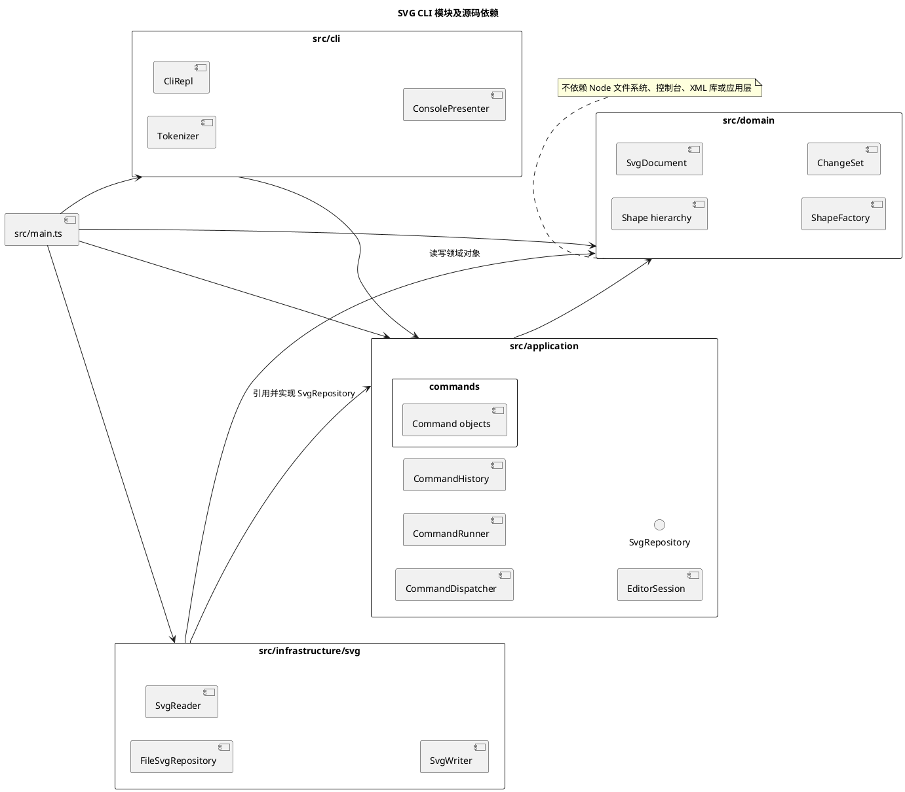
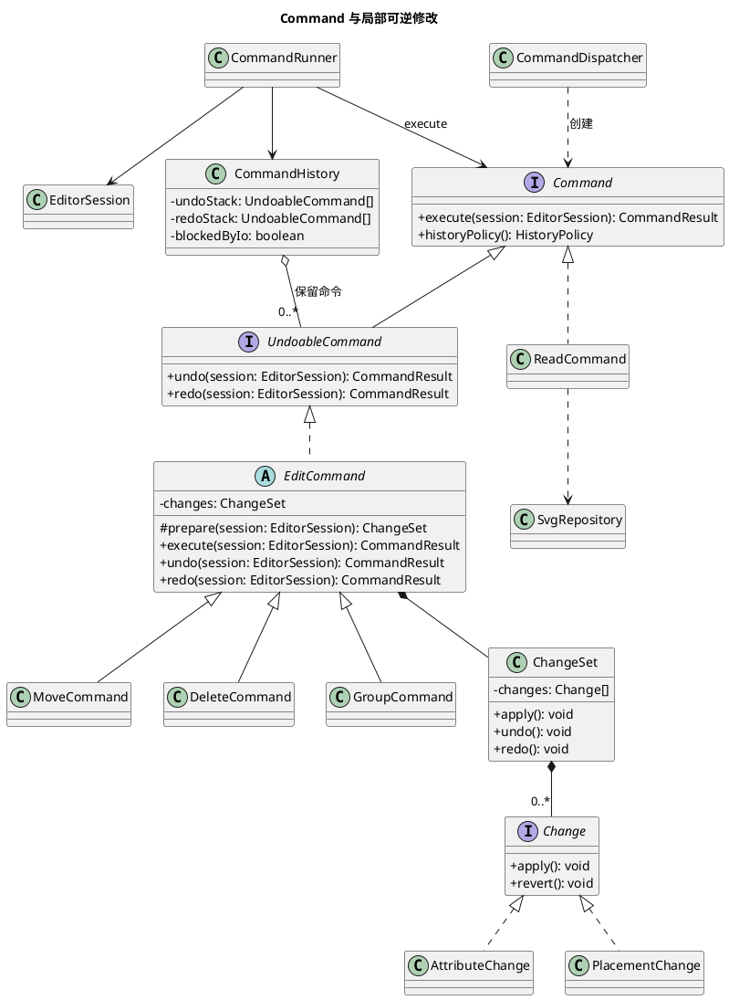
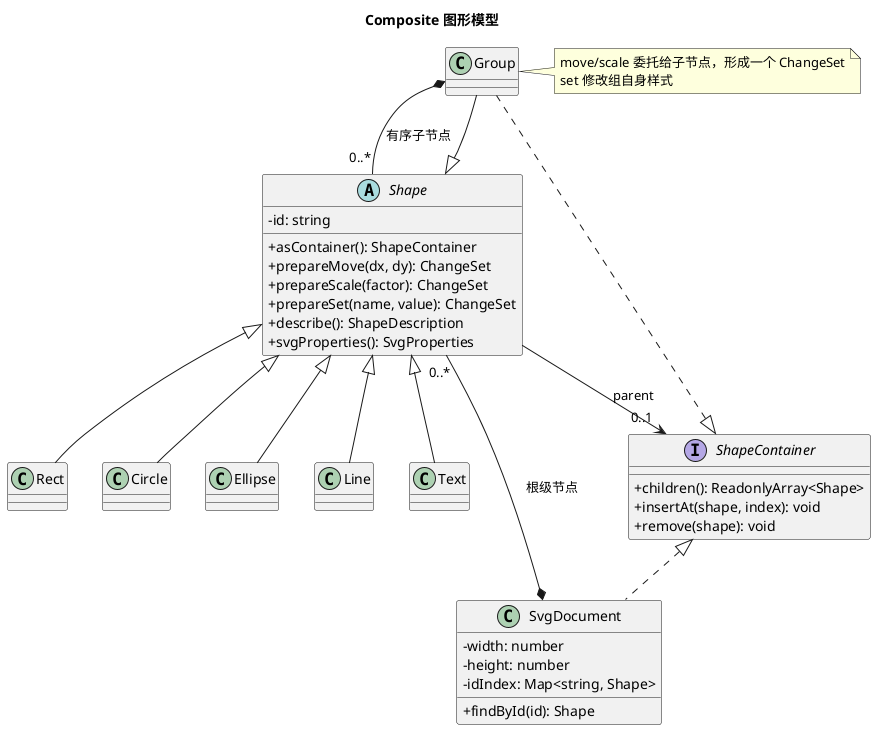

# SVG 编辑器（CLI）设计文档

依据：[phase_cli_1.md](../phase_cli_1.md)。本文件是实施前的设计方案，类名和目录均为计划，尚未落实为代码。

约束：TypeScript、面向对象、字段封装、一类一文件且文件名与类名一致；使用 Command 和 Composite；禁止文档快照；按名字分派仅允许出现在命令分发和图形工厂两处。

## 1. 架构方案

### 1.1 模块划分

| 模块（目录） | 职责 | 主要对象 |
|---|---|---|
| `src/domain/` | 图形几何和属性规则、唯一 id、文档树、父子关系及顺序；生成和执行可逆的局部修改 | `SvgDocument`、`Shape`、`Group`、六种内置图形、`ShapeFactory`、`ChangeSet` |
| `src/application/` | 命令对象、命令分发、编辑会话、执行流程、撤销重做；定义 SVG 存储接口 | `CommandDispatcher`、`CommandRunner`、`CommandHistory`、`EditorSession`、`SvgRepository` |
| `src/application/commands/` | 每条命令的参数检查、用例协调和结果生成；属于 application 模块 | `CreateCommand`、`MoveCommand`、`GroupCommand`、`ReadCommand` 等 |
| `src/infrastructure/svg/` | 文件与 XML 读写；保留子节点顺序，导入时补缺失 id，生成警告 | `FileSvgRepository`、`SvgReader`、`SvgWriter` |
| `src/cli/` | REPL、`svg>` 提示符、逐行输入、引号切分、整行注释识别及反馈输出 | `CliRepl`、`Tokenizer`、`ConsolePresenter` |
| `src/main.ts` | 创建具体对象、注入依赖并启动程序 | 组装入口 |

`application/commands/` 是应用层内部目录，不是独立架构层。接口、枚举和只读传输类型可以单独成文件；图形业务状态由类封装，不能通过公开可写字段绕过校验。

#### PlantUML 包图

箭头表示源码依赖。接口实现也需要引用接口，因此 infrastructure 指向 application；运行时 application 通过接口调用读写实现。

### 1.2 设计模式的选择与落地

#### Command：命令对象与撤销重做

`Command` 声明 `execute(session)` 和历史策略。`UndoableCommand` 在此基础上声明 `undo(session)`、`redo(session)`。每条输入创建独立命令实例，禁止把同一个可变命令对象重复用于多条历史记录。

`EditCommand` 是编辑命令的抽象基类，封装准备修改、执行、撤销和重做的共同流程；具体类负责表达各自的业务操作。`CommandRunner` 调用命令，`CommandHistory` 保存成功执行的编辑命令对象。

| 命令类别 | 计划类 | 历史策略 |
|---|---|---|
| 图形编辑 | `CreateCommand`、`DeleteCommand`、`MoveCommand`、`ScaleCommand`、`SetCommand`、`GroupCommand`、`UngroupCommand`、`AddToCommand`、`FrontCommand`、`BackCommand` | 成功后作为一个撤销单元入栈，同时清空 redo 栈 |
| 文档操作 | `InitCommand`、`ReadCommand`、`SaveCommand`、带尺寸的 `CanvasCommand` | 成功后建立历史屏障 |
| 查询 | `TreeCommand`、`ShowCommand`、`HelpCommand`、无尺寸的 `CanvasCommand` | 不入栈，不改变已有历史 |
| 历史控制 | `UndoCommand`、`RedoCommand` | 调用 `CommandHistory`，自身不入栈 |

历史策略由命令报告，执行器按策略处理，不能再次按命令名字分派。`CanvasCommand` 根据参数是否包含尺寸选择查询或屏障策略。

#### PlantUML 命令类图

#### 撤销记录：保存操作变化，禁止文档快照

不复制、克隆或序列化整个当前文档来实现撤销、重做或编辑事务。每个编辑命令只保存本次操作实际需要的记录。几何操作即使涉及整棵子树，也只记录受影响的数值属性，不记录完整图形或完整文档。

| 编辑命令 | 需要保留的记录 | 撤销与重做 |
|---|---|---|
| `create` | 创建出的原图形对象、父容器、插入位置 | 撤销时摘出；重做时重新挂入同一对象 |
| `delete` | 被摘出的原子树对象、原父容器和位置 | 撤销时挂回；重做时摘出；不复制子树 |
| `move` | 增量参数及本次改变的坐标属性旧值、新值 | 写回旧值或新值 |
| `scale` | 缩放参数及本次改变的几何属性旧值、新值 | 写回旧值或新值，避免乘倒数带来的浮点误差 |
| `set` | 属性名、原来是否存在、旧值、新值 | 恢复原值或原本的缺省状态；重做设置新值 |
| `group` | 新组对象及其位置、每个成员的原父容器和原位置、组内顺序 | 撤销移回成员并移除新组；重做恢复分组 |
| `ungroup` | 原组对象及其位置、被提升的子节点顺序 | 撤销挂回组并收回子节点；重做再次解散 |
| `addto` | 节点的原父容器和位置、目标容器和目标位置 | 撤销迁回；重做迁入 |
| `front/back` | 节点及原位置、目标位置 | 在同一父容器内恢复或调整位置 |

`AttributeChange` 记录一个属性的变化，包含“属性不存在”的状态。`PlacementChange` 记录一个节点从一个父容器及位置迁到另一个位置，父容器可为空以表示摘出或挂入。这些记录仅由领域操作创建，命令不能直接修改节点的内部数组或字段。

`ChangeSet` 按顺序执行修改，撤销时按相反顺序回退，重做时再次按顺序执行。一个 `group` 即使包含多次节点迁移，仍然只由一个 `GroupCommand` 入栈。

#### 失败不改变状态

执行前的准备阶段校验所有参数、目标存在性、id 冲突、属性白名单、数值范围、树循环和祖先子孙冲突，并构造局部修改记录。该阶段不改变文档。

应用修改时，如果中途出现异常，`ChangeSet` 回退已经执行的步骤。单个修改必须保证自身失败时不留下部分修改。父指针、子节点顺序和 id 索引由领域对象统一维护；撤销、重做也遵守相同约束。

失败的执行、撤销或重做不改变历史栈。历史管理器先取栈顶对象执行，成功后才移动到另一栈；准备失败的编辑命令不清空 redo 栈。

`read` 先解析并验证一个新文档，全部成功后才替换当前文档；这是导入结果，不是撤销快照。`save` 先生成 XML，再通过同目录临时文件写入和替换目标文件，成功后才更新会话信息及历史屏障。

#### 历史屏障

成功的 `init/read/save/canvas w h` 清空两个历史栈，并设置 `blockedByIo`。此时 `undo/redo` 均输出 `error: undo not allowed after io command`。下一条成功的编辑命令清除屏障并建立新的撤销记录；查询和失败的命令不解禁。

清空屏障前历史是本方案的补充决策：需求规定禁止撤销直到下一次编辑，但没有明确旧记录是否保留。丢弃旧记录可以避免跨文档恢复以及恢复到屏障前的状态。下一次编辑解除屏障后，若栈为空，使用普通的无历史错误。

#### Composite：容器与叶子的统一操作

`Shape` 封装 id、样式与图形操作；叶子类实现自己的几何属性，`Group` 持有有序子节点并递归处理移动和缩放。文档根实现 `ShapeContainer`，但不是可由 id 编辑的普通图形。

容器通过 `asContainer()` 暴露容器能力，叶子返回空；命令用统一接口处理对象，不按 `tag` 判断具体类。`set g fill/stroke/stroke-width` 修改组自身的 SVG 样式属性，由 SVG 继承规则决定后代外观；不会强制覆盖子图形已有的属性。

`describe()` 提供类型、关键属性和文本等只读描述，`ConsolePresenter` 负责展示布局。`svgProperties()` 提供标签、属性和文本，`SvgWriter` 负责 XML 转义与生成；领域层不引用 XML 库。

#### 工厂：集中图形类型分派

`ShapeFactory` 是唯一的“类型名 → 图形类”解析位置，供 `create` 和 `SvgReader` 共同使用。内置六种类型的参数定义及构造方式绑定在同一映射项中；应用层按定义归一化位置参数，导入层按定义转换 XML 属性，不再各写一套 `switch(tag)`。

本阶段明确标为待重构的两处：

| 位置 | 当前职责 | 后续重构方向 |
|---|---|---|
| `CommandDispatcher` | 命令名到命令构造器的内置映射，同时提供 help 元数据 | 增加命令注册入口 |
| `ShapeFactory` | 类型名到内置图形构造方式及参数定义的映射 | 改为 ShapeProvider 注册机制，统一创建与导入 |

### 1.3 依赖方向规则

以下规则覆盖源码 import 和运行时直接调用。接口实现属于源码依赖，不因采用依赖注入而豁免。

| 模块 | 允许依赖 | 理由 |
|---|---|---|
| `domain` | 自身内部模块、TypeScript/JavaScript 基础能力 | 领域规则能够脱离终端、文件系统和 XML 库运行 |
| `application` | 自身内部模块、`domain` | 用例协调领域对象；存储操作只引用本层声明的接口 |
| `infrastructure/svg` | 自身内部模块、`application` 的存储接口及传输类型、`domain`、Node 文件系统和 XML 库 | 实现存储接口，读写领域对象；不能调用执行器或历史栈 |
| `cli` | 自身内部模块、`application` 对外入口及结果类型、Node 终端能力 | 输入输出通过应用层完成，不直接修改图形或读写 SVG |
| `main.ts` | 上述全部模块 | 组装具体实现并注入依赖 |

接口 `SvgRepository` 位于 application，签名使用领域文档类型；`FileSvgRepository` 位于 infrastructure，实现该接口。application 不得 import `FileSvgRepository`、`node:fs` 或 XML 解析库。

违规示例：domain 引用 CLI 输出、application 引用具体存储类、CLI 直接操作 `Shape`、SVG 读取器修改撤销栈。发现违规时必须记为待处理项，修正依赖或如实修订方案；不能仅通过换目录名隐藏依赖。

当前尚无源码，因此依赖一致性状态为“待实现后检查”。

### 1.4 变化点假设

| 可能的变化 | 本阶段预留 | 当前取舍与理由 |
|---|---|---|
| 增加图形类型及复合图形 `box` | `Shape` 多态、容器能力、单一工厂入口；创建和读取共享类型定义 | 先实现六种内置类型，工厂映射列为待重构；不实现插件发现、加载和 box，以符合阶段边界 |
| 增加 agent 或鼠标输入渠道 | 命令对象与执行器独立于 REPL；命令接收已解析参数 | 新入口可以直接构造命令；CLI 语法不进入图形模型 |
| 命令参数和反馈格式变化 | 每条命令独立检查参数；Tokenizer 只处理词法；Presenter 负责排版 | 不引入通用语法引擎，当前命令规模可以由各命令类处理 |
| SVG 导入导出规则变化 | 存储接口、独立 Reader/Writer、共享图形工厂 | 先支持需求内的 SVG 子集；外部 transform 的支持范围须在实现导入时明确并记录，不能静默丢失图形位置 |
| 撤销记录的内存或性能需求变化 | 命令局部记录、ChangeSet、集中历史管理器 | 禁止文档快照；暂不实现持久化历史、无限历史和历史分支，后续可增加条数上限 |
| 层级与排列操作增多 | 统一父容器接口和节点位置修改；树不变量集中维护 | 新操作复用节点迁移，不允许直接写 children 数组 |
| 新存储目标或测试替身 | `SvgRepository` 接口 | 仅实现本地文件；暂不引入数据库、远程服务等额外设施 |

### 1.5 需求未明确处的设计决策

- `group` 来自不同父容器时，按执行前文档的深度优先顺序排列成员，新组插入第一个成员的原父容器和原位置；若同时选中祖先与子孙，预检查拒绝。顺序及位置记录用于精确撤销。
- `front` 表示视觉最前，移到同级子节点数组末尾；`back` 移到开头，符合 SVG 后绘制节点覆盖先绘制节点的顺序。
- 仅整行去除前导空白后以 `#` 开始时视为注释；参数中的 `#4a90d9` 是颜色值，不能截断。
- 缺 id 的导入分两步：先收集全部显式 id 并检查重复，再分配不冲突的 `标签名+序号`，防止自动生成的 id 抢占后面的显式 id。
- 按需求禁止解散 SVG 直接子节点上的根级 `g`；该限制由 `UngroupCommand` 的准备阶段检查。

## 2. 过程记录

| 日期 | 讨论与修订 | 结果 |
|---|---|---|
| 2026-10-13 | 阅读需求并提出初步分层方案；最初建议复制文档以支持事务和撤销 | 初稿存在文档快照方案 |
| 2026-10-13 | 用户明确“文档快照被禁止” | 删除文档复制方案，改为 Command 保存属性变化、节点原位置及被摘出的原对象，通过局部逆操作撤销 |
| 2026-10-13 | 用户要求初始化 Git 并创建含 UML 的 README | 建立 Git 仓库；编写包图、Command 类图、Composite 类图及依赖和变化点规则 |

后续实现发现的设计调整应追加记录，不能把计划直接改写成已经验证的结论。

## 3. 一致性自查

当前只有需求与设计文档，没有 TypeScript 实现。

| 检查项 | 当前状态 | 实现后检查方式 |
|---|---|---|
| 实际目录与模块方案一致 | 待检查 | 对照 src 目录；偏离之处记入过程记录 |
| 实际依赖遵守规则 | 待检查 | 检查 import，重点抽查 application、domain 和 infrastructure |
| 一类一文件、字段封装及多态 | 待检查 | 检查类文件和可写公开字段；抽查图形操作是否依赖类型判断 |
| 仅两处名字分派 | 待检查 | 检查命令名字和图形 tag 的分派位置；XML 读写及 tree/show 不重复分派 |
| 撤销不使用文档快照 | 待检查 | 检查命令持有的记录以及 undo/redo 路径，排除文档复制和序列化恢复 |

## 4. 质量保证手段

以下是计划执行的验证，当前尚未执行功能测试。

- 用需求的典型会话及两节点流程图回放，检查输出、嵌套操作、保存结果和浏览器预览。
- 对每种编辑命令验证 execute → undo → redo：核对属性存在性、数值、节点父级、同级顺序和 id 索引；覆盖容器删除、跨父级 group 和 ungroup。
- 针对错误命令验证文档及两栈不变，包括重复 id、无目标、非法属性、非正 scale、循环迁移和祖先子孙分组冲突。
- 用多步骤修改的中途失败场景验证 ChangeSet 回退，检查无节点丢失、无重复归属、索引一致。
- 验证 undo 后的新编辑清空 redo，失败编辑保留 redo；验证成功 I/O 屏障、失败 I/O 和 canvas 查询的区别。
- 验证 SVG 保存后读回的几何、样式、文本和顺序一致；覆盖 XML 转义、缺 id 自动命名及显式 id 冲突。
- 实现完成后执行 TypeScript 检查、必要测试和依赖检查，把实际结果补入本文件。
