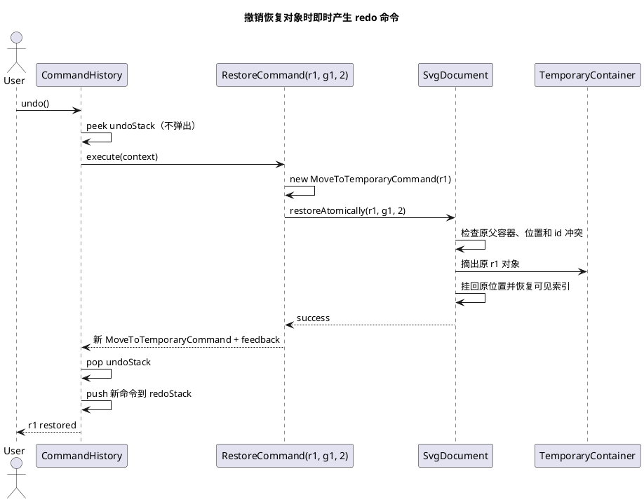

# 撤销、重做与隐藏临时容器伪代码

这是设计伪代码，尚未实现为可运行 TypeScript。采用用户提出的即时生成命令方案，禁止文档快照。“不被 sl”暂解释为不参与序列化，同时不出现在 tree/show 中。

两个栈保存待执行命令：

- 新编辑执行后，生成能撤销该编辑的命令，压入 undo 栈。
- undo 执行时，立即生成能恢复撤销前状态的命令，压入 redo 栈。
- redo 执行时，再次生成对应的撤销命令，压入 undo 栈。

例如：删除 → 返回恢复命令；撤销执行恢复命令 → 返回删除命令；重做执行删除命令 → 再返回恢复命令。每次返回新命令对象。

## 1. 命令和两栈

```text
interface ReversibleCommand:
    execute(context) -> EditResult
        // 成功：已完成一次原子编辑，返回当次生成的反向命令。
        // 失败：文档、隐藏容器及索引均不改变。

    retainedNodes() -> Set<NodeReference>
        // 返回该命令未来执行需要保留的对象及父容器引用。

class EditResult:
    inverse: ReversibleCommand
    feedback: Text

class CommandHistory:
    private undoStack = Stack<ReversibleCommand>()
    private redoStack = Stack<ReversibleCommand>()
    private blockedByIo = false

    executeNew(command, context):
        result = command.execute(context)       // 失败则直接抛出，不动两栈
        redoStack.clear()                       // 仅成功的新编辑清空 redo
        undoStack.push(result.inverse)
        blockedByIo = false
        collectUnusedTemporaryObjects(context)
        return result.feedback

    undo(context):
        requireHistoryAllowed()
        require not undoStack.empty(), "error: nothing to undo"
        pending = undoStack.peek()              // 先不弹出
        result = pending.execute(context)       // 此时立即生成 redo 命令
        undoStack.pop()                         // 成功后才改变历史
        redoStack.push(result.inverse)          // 压入新命令，而非 pending
        collectUnusedTemporaryObjects(context)
        return result.feedback

    redo(context):
        requireHistoryAllowed()
        require not redoStack.empty(), "error: nothing to redo"
        pending = redoStack.peek()
        result = pending.execute(context)       // 此时立即生成新的 undo 命令
        redoStack.pop()
        undoStack.push(result.inverse)
        collectUnusedTemporaryObjects(context)
        return result.feedback

    onIoSucceeded(context):
        undoStack.clear()
        redoStack.clear()
        blockedByIo = true
        collectUnusedTemporaryObjects(context)

    private requireHistoryAllowed():
        require not blockedByIo,
            "error: undo not allowed after io command"

    private collectUnusedTemporaryObjects(context):
        keep = Set<NodeReference>()
        for command in undoStack + redoStack:
            keep.addAll(command.retainedNodes())
        context.document.releaseUnneededTemporaryRoots(keep)
```

undo/redo 内部直接执行命令，不能调用 `executeNew`，否则会错误清空 redo 栈。栈更新和回收为预先保证不产生业务错误的内存操作；执行过程串行，不允许其他命令在中途改动文档。

## 2. 隐藏容器与访问边界

```text
class TemporaryContainer:
    private roots = IdentitySet<Shape>()
        // 按对象身份存储，不按 SVG id 查找。
        // 没有用户 id，不挂在可见 SVG 根下面。

    // 以下能力只供领域内部的原子迁移操作使用。
    containsRoot(node): ...
    attachRoot(node): ...
    detachRoot(node): ...
    rootsForInternalCollection(): ...

class SvgDocument:
    private visibleRoot: ShapeContainer
    private activeIdIndex: Map<string, Shape>
    private temporary: TemporaryContainer

    findActiveById(id):
        require activeIdIndex.contains(id), "error: no such shape: " + id
        return activeIdIndex[id]                // 不搜索 temporary

    visibleChildren():
        return visibleRoot.readonlyChildren()   // 不包含 temporary

    visiblePlacementOf(node):
        require isActive(node)
        return Placement(node.parent, node.parent.indexOf(node))

    moveToTemporaryAtomically(node):
        validate node 属于当前可见文档且不是 SVG 根
        // 同一次原子迁移中完成：
        // 1. 从原父容器移除 node。
        // 2. 将 node 作为原子树根挂入 temporary。
        // 3. 从 activeIdIndex 移除 node 及所有子孙的 id。
        // 任一步失败则按局部逆操作恢复；不复制文档。

    restoreAtomically(node, placement):
        validate temporary.containsRoot(node)
        validate placement.parent 是当前可见根或可见容器
        validate placement.index 是合法插入位置
        validate node 子树全部 id 不与 activeIdIndex 冲突
        // 同一次原子迁移中完成：
        // 1. 从 temporary 摘出 node。
        // 2. 按 placement 挂入原父容器。
        // 3. 将 node 及全部子孙重新加入 activeIdIndex。
        // 任一步失败则回到 temporary 并恢复索引。

class TreeCommand:
    execute(context):
        render context.document.visibleChildren()

class ShowCommand:
    execute(context):
        render context.document.findActiveById(requestedId)

class SvgWriter:
    serialize(document):
        return encodeSvg(document.visibleChildren())
        // 绝不从 document 的全部字段或内部容器开始遍历。
```

原子迁移具体应由封装的领域方法实现，不能让命令直接操作 roots、children 或 activeIdIndex。临时容器与被删对象都不能通过普通用户命令访问；恢复依靠历史命令保存的对象引用。

隐藏对象不参与可见文档的 id 唯一性检查，因此删除后可以复用 id。临时容器可以同时持有多个 id 相同、对象身份不同的历史对象；恢复前必须检查冲突。按线性历史撤销时，新对象会先被撤销，再恢复同 id 的旧对象。

## 3. 删除与恢复互相生成

```text
class DeleteCommand implements ReversibleCommand:
    private id

    execute(context):
        node = context.document.findActiveById(id)
        return new MoveToTemporaryCommand(node).execute(context)

    retainedNodes():
        return {}                              // 尚未执行的用户输入命令

class MoveToTemporaryCommand implements ReversibleCommand:
    private node: ShapeReference

    execute(context):
        oldPlacement = context.document.visiblePlacementOf(node)
        inverse = new RestoreCommand(node, oldPlacement)
        context.document.moveToTemporaryAtomically(node)
        return EditResult(inverse, node.id + " deleted")

    retainedNodes():
        return {node}

class RestoreCommand implements ReversibleCommand:
    private node: ShapeReference
    private placement: Placement

    execute(context):
        inverse = new MoveToTemporaryCommand(node)
        context.document.restoreAtomically(node, placement)
        return EditResult(inverse, node.id + " restored")

    retainedNodes():
        return {node, placement.parent}
        // 父容器日后也可能被删，仍须保留以供恢复。
```

逆命令在当前执行过程中构造，并在修改成功后返回入栈。隐藏容器、命令及可见树始终引用同一对象，删除一个 Group 保留其整棵子树及内部顺序。

创建也遵循同一方案：CreateCommand 将新对象挂入可见树后，返回 MoveToTemporaryCommand；撤销创建将其移入临时容器，并生成 RestoreCommand 供 redo 使用。

## 4. 属性修改与多步骤命令

属性修改也在每次执行时读取被改属性的原值并生成逆命令，包含“原属性不存在”的状态。

```text
class SetPropertyCommand implements ReversibleCommand:
    private node: ShapeReference
    private attributeName
    private desired: PropertyValueOrAbsent

    execute(context):
        context.document.requireActive(node)
        node.validateProperty(attributeName, desired)
        previous = node.readPropertyOrAbsent(attributeName)
        inverse = new SetPropertyCommand(node, attributeName, previous)
        node.writePropertyAtomically(attributeName, desired)
        return EditResult(inverse, "property updated")

    retainedNodes():
        return {node}

class CommandBatch implements ReversibleCommand:
    private commands: List<ReversibleCommand>

    execute(context):
        inverses = List<ReversibleCommand>()
        try:
            for command in commands:
                result = command.execute(context)
                inverses.append(result.inverse)
        catch failure:
            for inverse in reverse(inverses):
                inverse.execute(context)       // 回退已成功步骤，返回值丢弃
            throw failure
        return EditResult(
            new CommandBatch(reverse(inverses)),
            "batch completed"
        )

    retainedNodes():
        return union(command.retainedNodes() for command in commands)
```

`move/scale` 根据图形多态计算本次受影响属性的目标值，组成 SetPropertyCommand 批次。撤销写回原数值，执行撤销时捕获此刻数值并生成 redo，避免用加减或乘倒数恢复产生浮点误差。

`group/ungroup` 的节点迁移也包装为单个 CommandBatch。批次尽量预检查业务条件；所有子命令必须具备原子性，且逆命令能在当前串行上下文中可靠回退。批次内部不操作历史、不回收临时对象、不执行文件 I/O；只有完整成功后才由历史管理器更新两栈并回收。

## 5. 临时对象回收

不能在清空 redo 时直接清空整个临时容器，因为 undo 栈可能仍需要恢复其中的对象。

```text
class SvgDocument:
    releaseUnneededTemporaryRoots(retainedNodes):
        keptRoots = IdentitySet<Shape>()
        for ref in retainedNodes:
            root = temporaryRootContaining(ref)
                // 沿父关系查找；若引用在可见树中，则返回空。
                // 引用隐藏子孙或隐藏父容器时，保留所属整棵隐藏子树。
            if root exists:
                keptRoots.add(root)

        for root in temporary.rootsForInternalCollection():
            if root not in keptRoots:
                temporary.detachRoot(root)
                // 取消隐藏根归属；无历史引用后由运行时回收。
```

成功 `save/canvas w h` 建立历史屏障后，两栈清空，临时对象可以全部释放。成功 `init/read` 清空历史并替换文档，旧文档及其临时容器一起释放。失败 I/O 不清空历史；显示类命令不触发历史变化。

## 6. 执行轨迹与 UML

假设 r1 原本位于 g1 的第 2 个位置：

| 操作 | 可见树 | 临时容器 | undo 栈顶 | redo 栈顶 |
|---|---|---|---|---|
| delete r1 | r1 被移出 | 同一个 r1 对象 | Restore(r1, g1, 2) | 空 |
| undo | r1 回到 g1 原位置 | 空 | 空 | 新生成的 MoveToTemporary(r1) |
| redo | r1 再次被移出 | 同一个 r1 对象 | 新生成的 Restore(r1, g1, 2) | 空 |



实现时需要验证：重复 undo/redo 保持对象身份；删除容器时全部子孙不可查询；同 id 新旧对象按历史顺序正确恢复；失败命令保留两栈；新编辑只回收废弃历史需要的隐藏对象；保存不包含临时容器及其对象。这些是待执行的验证，不代表伪代码已通过运行测试。
